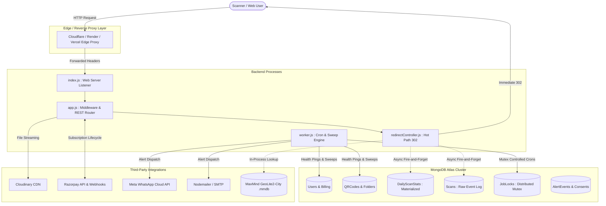
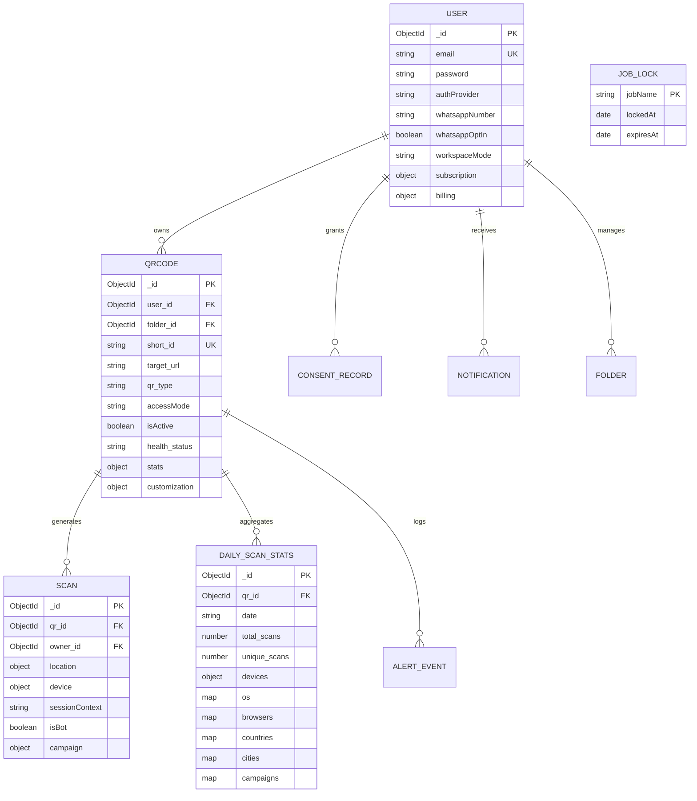

# Architecture Context: QRVibe

> **Architectural Paradigm:** Provider-Agnostic, High-Performance Micro-Architecture  
> **Backend:** Node.js (ESM), Express.js, MongoDB Atlas (Mongoose ODM)  
> **Frontend:** React 18, Vite, Tailwind CSS, Redux Toolkit  
> **Last Updated:** October 2026

---

## 1. System Topology & Architectural Invariants

QRVibe is built with a decoupled architecture ensuring horizontal scalability, zero cloud vendor lock-in, sub-50ms redirect response times, and full compliance with DPDP data privacy standards.



---

## 2. The Unbreakable Architectural Laws

The following laws are non-negotiable architectural mandates enforced across all pull requests, agent tasks, and refactors:

### Law 1: Provider-Agnostic Infrastructure
* The application must never depend on Render, AWS, Railway, or Vercel proprietary server runtime primitives.
* **Process Separation Mandate:** Entrypoints are strictly decoupled:
  * [app.js](file:///d:/Projects/qr-code/backend/app.js): Express app instance, rate limiters, CORS, routes. Does *not* bind ports or connect to MongoDB.
  * [index.js](file:///d:/Projects/qr-code/backend/index.js): HTTP server runner. Connects to database and mounts `app.js`.
  * [worker.js](file:///d:/Projects/qr-code/backend/worker.js): Isolated background worker process running cron tasks.
* **Instance Control:** Configured via environment flags: `RUN_WORKER=true` and `ENABLE_IN_PROCESS_JOBS=true` (single-instance fallback).

### Law 2: Zero-Latency & Stateless Geolocation
* The critical redirect path (`GET /r/:shortId`) must *never* be blocked by external network HTTP API calls.
* **Hybrid Extraction Hierarchy:**
  1. **CDN Edge Headers:** Extract `cf-ipcountry`, `cf-ipcity`, `x-vercel-ip-country`, `x-vercel-ip-city`.
  2. **In-Process MaxMind Database:** Fast binary lookup via [GeoLite2-City.mmdb](file:///d:/Projects/qr-code/backend/data/GeoLite2-City.mmdb) in memory.
  3. **LRU Cached API Fallback:** Async secondary lookup (`freeipapi.com`) strictly in the background with a 24-hour LRU cache (5,000 max entries).
* **Reverse Proxy Trust:** Backend mandates `app.set('trust proxy', 1)` to accurately resolve `req.ip` and client hops.

### Law 3: DPDP-Compliant Unique Scanner Hashing
* **Raw IP Ban:** Raw IP addresses must *never* be stored in the database.
* **Session Context Hash:** Scanners are uniquely tracked via a SHA-256 digest:
  $$\text{sessionContext} = \text{sha256}(\text{normalizedIp} + \text{userAgent} + \text{ANALYTICS\_SALT})$$
* **Static Salt Mandate:** `ANALYTICS_SALT` is static across environments. Daily rotating salts are strictly prohibited because they break 30-day cohort retention analysis.

### Law 4: Materialized Views for Analytics
* The analytics dashboard must *never* run expensive `$group` aggregations over the raw `Scan` collection during dashboard requests.
* **Materialized Collection:** Pre-aggregated metrics are maintained inside [DailyScanStats.js](file:///d:/Projects/qr-code/backend/models/DailyScanStats.js).
* **Atomic Upserts:** Redirects execute atomic `$inc` updates inside non-blocking `Promise.allSettled()` chains.

### Law 5: Distributed Mutex Locks for Background Jobs
* Cron jobs and expiration sweeps must *never* execute concurrently across horizontally scaled instances.
* Every background job is wrapped in [withJobLock()](file:///d:/Projects/qr-code/backend/utils/jobLock.js) backed by the [JobLock](file:///d:/Projects/qr-code/backend/models/JobLock.js) collection.
* Orphaned locks are automatically cleaned up via a MongoDB TTL index on `expiresAt` (`expireAfterSeconds: 0`).

### Law 6: Alert Delivery & Anti-Flapping Cooldown
* **No Twilio Dependency:** WhatsApp notifications must communicate directly with the Meta WhatsApp Cloud API using pre-approved `UTILITY` templates.
* **12-Hour Cooldown:** Broken links must log an event in [AlertEvent](file:///d:/Projects/qr-code/backend/models/AlertEvent.js). Alerts are muted if an alert for the same QR code was dispatched within the previous 12 hours.
* **Raw Webhook Body:** `POST /api/webhooks` must mount `express.raw({ type: 'application/json' })` **before** global `express.json()` to preserve HMAC-SHA256 signature verification (`x-hub-signature-256`).

---

## 3. Storage & Data Models (MongoDB Mongoose)



### Key Schema Details & Index Strategies
1. **`User.js`:**
   * Indexes: `{ email: 1 }` (unique).
   * Password hashing: Bcrypt pre-save hook (salt rounds: 5).
   * JWT methods: `generateAccessToken()` (15m), `generateRefreshToken()` (7d).
   * Workspace Mode: `workspaceMode` enum (`'storefront'`, `'marketing'`, default: `null`). Governs progressive disclosure across dashboard navigation, overview cards, and creation options.
2. **`QRCode.js`:**
   * Indexes: `{ short_id: 1 }` (unique), `{ user_id: 1, accessMode: 1 }`, `{ folder_id: 1 }`.
   * Access modes: `'dynamic_active'`, `'static_locked'`, `'disabled'`.
   * Pre-save hook: Sanitizes URL prefixes for real HTTP types.
3. **`DailyScanStats.js`:**
   * Compound Unique Index: `{ qr_id: 1, date: -1 }` (guarantees atomic upsert per QR per calendar date).
   * Uses Mongoose `Map of Number` for dynamic attributes (`os`, `browsers`, `cities`, `countries`, `campaigns`).
4. **`Scan.js`:**
   * Compound Indexes: `{ qr_id: 1, createdAt: -1 }`, `{ owner_id: 1, createdAt: -1 }`, `{ qr_id: 1, sessionContext: 1, createdAt: -1 }`.
   * DPDP Data Retention: Anonymized/purged after 24 months.
5. **`ConsentRecord.js`:**
   * Historical immutable ledger indexing `{ user_id: 1, consentType: 1, createdAt: -1 }`.
6. **`AlertEvent.js`:**
   * Index: `{ qr_id: 1, createdAt: -1 }` for fast 12-hour anti-flapping checks.
7. **`JobLock.js`:**
   * TTL Index: `{ expiresAt: 1 }` with `expireAfterSeconds: 0`.

---

## 4. The Hot Path: Redirection & Analytics Pipeline

When an incoming scan hits `GET /r/:shortId`:

```
Incoming Scan ──────────┐
                        ▼
            [1. Pre-load Deduplication Check]
            (5-second in-memory LRU cache "ip|shortId")
                        │
                        ▼
            [2. Document Lookup: QRCode.findOne]
            (Check isActive & accessMode !== 'disabled')
                        │
                        ▼
            [3. Instant HTTP 302 Redirect] ────────► Client Browser
                        │
                        ▼ (Background Promise.allSettled)
            [4. Asynchronous Analytics Execution]
            ├─ 4a. Hybrid Geo Extraction (Edge Headers -> In-memory MaxMind -> LRU API)
            ├─ 4b. Session Hash Generation (SHA-256 of IP + UA + Salt)
            ├─ 4c. Bot Detection Check (Regex crawler filtering)
            ├─ 4d. Raw Scan Record Creation (Scan.create)
            └─ 4e. Materialized View Increment (DailyScanStats.findOneAndUpdate $inc)
```

---

## 5. Client-Side QR Generation & Design Studio Model

Rendering is performed client-side using `qr-code-styling` to ensure server CPU remains unburdened by heavy canvas/rasterization tasks:

### Customization Specification (`customization` JSON):
```json
{
  "qrStyle": "dots",
  "fgColor": "#3B82F6",
  "fgColor2": "#8B5CF6",
  "gradientType": "linear",
  "bgColor": "#FFFFFF",
  "eyeShape": "extra-rounded",
  "eyeColor": "#5B3FF4",
  "logoUrl": "https://res.cloudinary.com/.../logo.png"
}
```

* **Vector Export Standards:** Exported to PNG (high DPI canvas raster), JPEG, SVG (pure DOM SVG serialization), and PDF (SVG wrapped in vector PDF document).
* **Safety Contrast Audit:** Client-side safety check compares luminance between `bgColor` and `fgColor` using the WCAG 2.1 contrast calculation before allowing export.
