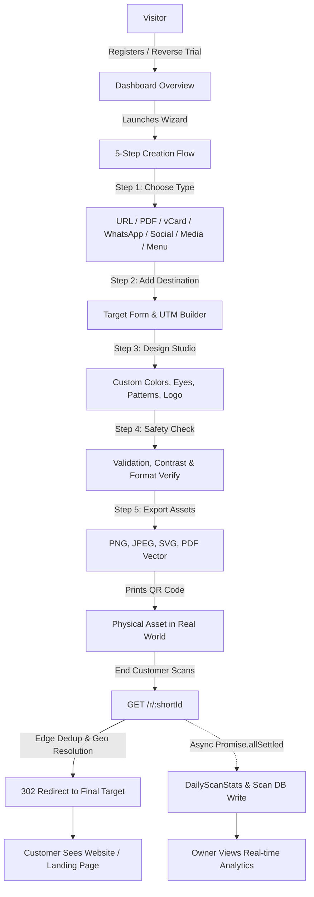

# Project Overview: QRVibe

> **Platform:** QRVibe (qrvibe.in)  
> **Type:** In-Store Digital Front-Desk & Google Review Engine for Indian Storefronts  
> **Primary Market:** India-first (expanding globally)  
> **Last Updated:** October 2026  
> **Status:** Production-Grade / Active Development (Spec-Driven)

---

## 1. Executive Summary & Strategic Positioning

**QRVibe** is the **In-Store Digital Front-Desk & Google Review Engine** for local brick-and-mortar storefronts (salons, spas, cafes, and healthcare clinics). 

Rather than competing as a generic "dynamic QR code utility" (a commoditized market dominated by global horizontal generators), QRVibe combines **edge-optimized dynamic routing**, **hosted visual micro-pages**, **AI-assisted Google Review capture**, and **custom physical countertop hardware** into an all-in-one in-store growth engine.

### Core Value Proposition:
1. **The Anti-Hostageware & Zero-Reprint Guarantee:** Real-world printed materials never expire or break. QRVibe rejects the predatory "14-day trial deactivation" trap common in legacy tools; customer storefronts stay archived and recoverable even during billing pauses.
2. **Visual In-Store Storefront (Browse & Upsell First):** High-fidelity mobile landing pages for restaurant menus, salon rate cards, and clinic care sheets. Features high-res imagery, Veg/Non-Veg and category filters, "Today's Special" banners, and 1-tap "Call Waiter / Request Bill" actions (eliminating greasy paper and expensive reprint runs).
3. **AI Google Review Booster + 1-to-3 Star Private Shield:** 
   * **4–5 Stars:** AI drafts natural, keyword-rich review options for Google Maps with 1-tap copy & submit (overcoming guest typing inertia).
   * **1–3 Stars (The Shield):** Routes unhappy customers directly into a private WhatsApp complaint channel to the owner, resolving dissatisfaction on-site before public Google ratings are damaged.
4. **"Snap-to-Page" AI Onboarding:** Zero typing friction. Merchants upload photos of their paper menu or rate card; Gemini 2.5 Flash Vision automatically extracts and categorizes dishes, services, and prices into a live page in under 60 seconds.
5. **Physical Hardware Trojan Horse:** 2-Sided heavy-duty acrylic/wooden countertop standees:
   * **Side A (Customer Facing):** Clear "Scan with Phone Camera" framing + food/scissors center icon for digital menu/rate card and Google reviews.
   * **Side B (Merchant Payment):** Merchant's existing UPI QR (PhonePe/GPay/Paytm) for clean table bill settlement, eliminating table clutter and UPI muscle-memory confusion.
6. **Monday Morning WhatsApp Push Digest:** Automated weekly delivery of scan counts, review clicks, and top-viewed items directly to the owner's WhatsApp, proving software value weekly without requiring desktop dashboard logins.
7. **Data Privacy by Design (DPDP):** Full compliance with India's Digital Personal Data Protection Act using salted SHA-256 session context hashing instead of storing raw PII or IP addresses.

---

## 2. Target Personas & Market Positioning

```
                          COMPLEXITY & ADOPTION FRICTION
                                      ▲
                                      │
                     Enterprise CPG   │   Full-Service Fine Dining
                     (Uniqode zone)   │   (Petpooja POS zone)
                                      │
  GENERIC ◄───────────────────────────┼───────────────────────────► VERTICAL
  REDIRECTS                           │                             WORKFLOWS
                                      │   ⭐ QRVIBE BEACHHEAD:
                     Freelancers &    │   • Salons, Spas & Beauty
                     One-Off Events   │   • Casual Cafes & QSRs
                     (High Churn)     │   • Dental & Wellness Clinics
                                      │   • Local Coaching Academies
                                      │
                                      ▼
                           LOW ACQUISITION COST & HIGH RETENTION
```

### 2.1 Beachhead Focus (P0 — Immediate Execution)
* **Salons, Spas & Beauty Clinics (3,60,000+ in India):**
  * *Pain Point:* Paper rate cards get oily/stained, cannot showcase bridal lookbooks or seasonal packages; Google reviews dictate new walk-in trust.
  * *QRVibe Solution:* Mirror-standee QR with visual service rate card, bridal lookbook gallery, 1-tap WhatsApp consultation booking, and Google Review Booster with Bad Review Shield.
* **Boutique Cafes, Bakeries & QSRs (Standalone Eateries):**
  * *Pain Point:* High reprinting costs when coffee/ingredient prices fluctuate; bleed 1.5%–3% commission on DotPe or pay ₹32k/yr for Petpooja POS bloat.
  * *QRVibe Solution:* 4 designer menu templates, "Today's Special" highlight banner, dish search, instant item sold-out toggles, and table Google Review standees.

### 2.2 Expansion Verticals (P1 — Month 2–3)
* **Dental & Wellness Clinics:** Waiting-room QR standees with doctor credentials, clinic hours, post-treatment care PDF libraries (root canal, skin care), and appointment inquiries.
* **Local Coaching Centers & Academies:** Reception desk QR showing course brochures, faculty results, and demo class booking links.

### 2.3 Explicitly Excluded / Deprecated Segments
* ❌ **Solo Freelancers (vCard-only):** Low willingness to pay recurring monthly SaaS; Indian market saturated by one-time ₹499 NFC physical cards (TapSticky, ProfileTap).
* ❌ **One-Off Events & Weddings:** High churn (~80% within 60 days) as soon as the weekend event concludes.
* ❌ **Full-Stack Restaurant POS / KDS:** Never compete head-on against Petpooja or DineOpen on kitchen ticket printing and raw inventory ERP.

---

## 3. Business Model & Pricing Architecture

> **STATUS:** **[PENDING FINALIZATION]** — Under active evaluation.

### Pricing Principles Agreed:
* **Anti-Churn Focus:** Avoid monthly UPI AutoPay friction (which suffers 8%–15% monthly mandate failure in India). Prefer annual prepaid bundles (including physical standees) to lock in customer retention.
* **Dual-Track Approach:**
  * *Domestic (India):* Localized INR pricing with GST invoice (Input Tax Credit), delivered physical standee bundles, and UPI/Card checkouts.
  * *International:* Clean self-serve USD digital SaaS ($5.99–$9.99/mo or ~$49/yr) without hardware fulfillment.
* **Anti-Hostage Policy:** Soft grace periods on expired plans with 12-month data archiving rather than instant destructive link breaking.

---

## 4. Core User Flows & System Topology



### 1. Onboarding & Reverse Trial Flow
* User registers via Email/Password or Google OAuth.
* Account initializes automatically with 14-Day **Pro Trial** access (`subscription.status = "trialing"`).
* First-time QR celebration banner (`hasCreatedFirstQR`) guides the user to immediate value creation.
* On day 14, background sweeper checks expiration and soft-locks excess codes (`accessMode: 'static_locked'`) without breaking live redirects.

### 2. 5-Step Unified Creation Wizard
* **Step 1 (Choose Type):** Select from 7 dynamic QR types.
* **Step 2 (Destination Form):** Dynamic form adapting to content type (direct URL, Cloudinary upload for PDF/Media, vCard fields, or menu categories).
* **Step 3 (Design Studio):** Live interactive canvas preview via `qr-code-styling` supporting dot styles, corner shapes, custom gradients, and brand logos.
* **Step 4 (Safety Check):** Automated pre-publish audit checking URL formatting, color contrast ratio, and UTM tracking tags.
* **Step 5 (Download & Actions):** High-resolution export (PNG, JPEG, SVG, PDF vector), short link copying, and live test scanning.

### 3. Redirection & Scan Journey (The Hot Path)
* End-user scans physical QR pointing to `qrvibe.in/r/:shortId`.
* Redirection engine parses client IP, checks 5-second preload deduplication cache, validates QR state, and returns `302 Redirect` immediately.
* Asynchronously in the background: executes hybrid geolocation (CDN edge headers -> LRU cached MaxMind/API), computes salted SHA-256 session hash, and atomically increments daily aggregate counters.

### 4. In-Store Engagement & Review Flow
* End-user scans physical QR standee (`qrvibe.in/r/:shortId`).
* Redirection engine resolves destination immediately:
  * For digital menus / rate cards: opens visual mobile catalog with photos, Veg/Non-Veg filters, "Today's Special", and "Call Waiter / Request Bill".
  * For review codes: displays the **AI Review Assistant** (4–5 stars generates natural copyable review drafts; 1–3 stars routes to private WhatsApp complaint form).
* Asynchronously: logs DPDP-compliant session hash, edge geolocation, and daily materialized statistics.

### 5. Link Health & Background Monitoring Flow
* Midnight cron job (`healthMonitor.js`) silently checks external URLs for genuine 404/DNS failures (ignoring 403/429 bot-blockers).
* Verified failures trigger in-app bell notification and email alert (demoted from primary customer-facing marketing feature to silent infrastructure assurance).

---

## 5. Feature Matrix

| Feature Module | Current Status | Description |
| :--- | :--- | :--- |
| **Dynamic Short Redirection** | Production | Sub-50ms 302 redirect engine with pre-load dedup and custom slug support |
| **AI Snap-to-Page Importer** | Production | Multimodal Gemini Flash OCR extracting paper menus/rate cards into structured JSON in <60s |
| **Visual Menus & Catalogs** | Production | 4 designer mobile templates (Modern, Playful, Immersive, Lighthouse) with dish photos & special tags |
| **AI Google Review Booster** | In Development | 5★ AI draft generator + 1–3★ Private WhatsApp Owner Shield |
| **2-Sided Standee Hardware** | Specified | Heavy-duty acrylic countertop standee (Side A: Menu/Reviews; Side B: Merchant UPI QR) |
| **Monday WhatsApp Digest** | Specified | Automated weekly scan & review summary pushed directly to merchant WhatsApp |
| **Hybrid Geolocation Engine** | Production | CDN headers -> MaxMind GeoLite2 -> FreeIPAPI with LRU caching |
| **GPS Reverse Geocoding** | Production | High-accuracy coordinate reverse geocoding via BigDataCloud with OSM fallback |
| **Materialized Analytics** | Production | Pre-aggregated daily scan records (`DailyScanStats`) for instant dashboard rendering |
| **DPDP Privacy & Consent** | Production | Salted SHA-256 session hashing, immutable `ConsentRecord` ledger, data export & erasure |
| **5-Step Creation Wizard** | Production | Unified flow inside `DashboardShell` with real-time `qr-code-styling` canvas |
| **Link Health Monitor** | Production | Silent background checker with 12-hour anti-flapping cooldown & email alerts |
| **Custom CNAME Domains** | Planned | Support for branded client domains (`menu.clientbrand.com`) on Growth tier |

---

## 6. Scope Boundaries

### Strictly IN-SCOPE
* Visual in-store storefronts (menus, service rate cards, lookbooks, clinic care sheets).
* AI Snap-to-Page menu/catalog extraction from photos.
* AI Google Review acceleration with private 1-to-3 star customer resolution firewall.
* 2-Sided countertop standee fulfillment and vinyl sticker conquest overlays.
* Monday morning push analytics via WhatsApp.
* Sub-50ms instant redirection with DPDP-compliant unique scanner hashing.
* India-first billing via Razorpay with automated webhook lifecycle and GST compliance.

### Strictly OUT-OF-SCOPE (Explicitly Rejected / Deprecated)
* **Forced Dine-In WhatsApp Table Ordering:** Demoted; Indian diners value waiter service. Table ordering remains an optional toggle for cloud kitchens/takeaway, not the primary headline.
* **Stable Diffusion "AI QR Art":** 2023 gimmick; expensive GPU cost, high scan failure rate on budget phones, zero merchant ROI.
* **Full-Stack Restaurant POS / KDS:** Never compete head-on against Petpooja or DineOpen on kitchen ticket printing and raw inventory ERP.
* **Native Mobile Apps (iOS/Android):** Responsive mobile web is 100% sufficient for scanners and merchants.
* **Raw IP or Exact GPS Storage Without Consent:** Strictly banned under DPDP compliance architecture.
