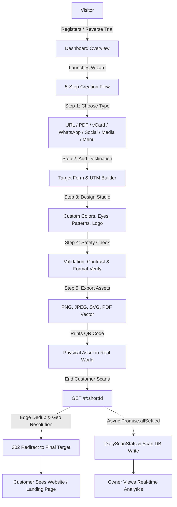

# Project Overview: QRVibe

> **Platform:** QRVibe (qrvibe.in)  
> **Type:** B2B Dynamic QR Code Management & Scan Analytics SaaS  
> **Primary Market:** India-first (expanding globally)  
> **Last Updated:** October 2026  
> **Status:** Production-Grade / Active Development

---

## 1. Executive Summary & Vision

**QRVibe** is a high-performance, developer-grade B2B SaaS platform designed to eliminate the single biggest failure point of offline print marketing: **dead, static, un-trackable QR codes**.

Unlike free or generic QR generators that produce static, unmodifiable images, QRVibe generates **dynamic short links** (`/r/:shortId`) backed by an edge-optimized redirection and analytics engine. Businesses can modify destination URLs, file assets, design aesthetics, or campaign parameters at any moment without reprinting physical packaging, table tents, storefront stickers, or billboards.

### Core Value Proposition:
1. **Zero Reprints Guarantee:** Real-world printed materials never expire or break. Change targets on the fly.
2. **Deep Scan Intelligence:** Real-time city-level geolocation, device breakdowns, browser tracking, and automated UTM campaign parameter injection.
3. **Automated Link Health Monitoring:** Continuous background health-checking sweeps detect 404/500 errors on client destination URLs and dispatch instant alerts via SMTP Email and Meta WhatsApp Cloud API.
4. **Data Privacy by Design (DPDP):** Full compliance with India's Digital Personal Data Protection Act using salted SHA-256 session context hashing instead of storing raw PII or IP addresses.
5. **India-First Financial Integration:** Native support for Razorpay UPI AutoPay, Net Banking, GST-compliant invoicing (15-character GSTIN validation), and localized rupee pricing alongside Stripe for international billing.

---

## 2. Business & Technical Goals

### 2.1 Technical Goals
* **Sub-50ms Redirection Hot Path:** Deliver instant 302 redirects by isolating all analytics logging, geolocation resolution, and materialized view increments into non-blocking, fire-and-forget asynchronous promises.
* **Provider-Agnostic Infrastructure:** Zero tight coupling to platform-specific primitives (Render, Vercel, Railway, AWS). Strictly isolate HTTP routing (`app.js`), web server lifecycle (`index.js`), and background workers (`worker.js`).
* **High-Throughput Materialized Analytics:** Eliminate real-time `$group` aggregations over millions of raw scan rows by incrementing pre-aggregated daily buckets in `DailyScanStats` with atomic MongoDB `$inc` operators.
* **Resilient Distributed Cron Execution:** Utilize MongoDB-backed distributed mutex locks (`JobLock`) with TTL auto-expiration to guarantee idempotency across horizontally scaled instances.

### 2.2 Business KPIs
* **Free-to-Paid Conversion:** Drive user conversion via a 14-day Reverse Trial strategy (granting full Pro access at signup, then soft-locking excess QRs to `static_locked` on expiration).
* **Scan Reliability (99.99% Uptime):** Ensure printed QR codes reliably redirect even under traffic spikes or external API degradations.
* **Zero Customer Churn due to Broken Destinations:** Provide proactive link health alerts before customers discover broken marketing campaigns.

---

## 3. Target Personas & Market Positioning

### Primary Persona: Indian SMBs & Storefronts
* **Restaurants & Cafes:** Dynamic table menus, review collection, Google Maps links, and WhatsApp ordering.
* **Retail Stores & Boutiques:** Promotional offers, Instagram bio links, customer feedback, and seasonal catalogs.
* **Real Estate & Healthcare:** Virtual property brochures, doctor appointment scheduling, and vCard contact cards.

### Secondary Persona: Marketing Teams & Agencies
* **Performance Marketers:** Multi-channel campaigns with automated UTM parameters (`utm_source=qrvibe`, `utm_medium=qr_code`, `utm_campaign=<slug>`) feeding directly into Google Analytics.
* **Event Organizers & Brand Managers:** High-volume printed flyers, attendee ticketing, and media showcase pages.

---

## 4. Core User Flows

### 1. Onboarding & Reverse Trial Flow
* User registers via Email/Password or Google OAuth.
* Account initializes automatically with 14-Day **Pro Trial** access (`subscription.status = "trialing"`).
* First-time QR celebration banner (`hasCreatedFirstQR`) guides the user to immediate value creation.
* On day 14, background sweeper checks expiration and soft-locks excess codes (`accessMode: 'static_locked'`) without breaking live redirects.

### 2. 5-Step Unified Creation Wizard
* **Step 1 (Choose Type):** Select from 7 dynamic QR types.
* **Step 2 (Destination Form):** Dynamic form adapting to content type (direct URL, Cloudinary upload for PDF/Media, vCard fields, or menu categories).
* **Step 3 (Design Studio):** Live interactive canvas preview via `qr-code-styling` supporting dot styles, corner shapes, custom gradients, and brand logos.
* **Step 4 (Safety Check):** Automated pre-publish audit checking URL formatting, color contrast ratio, and UTM tracking tags.
* **Step 5 (Download & Actions):** High-resolution export (PNG, JPEG, SVG, PDF vector), short link copying, and live test scanning.

### 3. Redirection & Scan Journey (The Hot Path)
* End-user scans physical QR pointing to `qrvibe.in/r/:shortId`.
* Redirection engine parses client IP, checks 5-second preload deduplication cache, validates QR state, and returns `302 Redirect` immediately.
* Asynchronously in the background: executes hybrid geolocation (CDN edge headers -> LRU cached MaxMind/API), computes salted SHA-256 session hash, and atomically increments daily aggregate counters.

### 4. Link Health & Proactive Alerting Flow
* Midnight cron job (`healthMonitor.js`) sweeps active URL-type QR codes.
* Issues lightweight HTTP `HEAD` ping (falling back to `GET` on 405/403).
* If failure is detected, verifies 12-hour alert cooldown in `AlertEvent` collection.
* Dispatches multi-channel notification: Dashboard notification -> SMTP Email -> Meta WhatsApp Cloud API.

---

## 5. Feature Matrix

| Feature Module | Current Status | Description |
| :--- | :--- | :--- |
| **Dynamic Short Redirection** | Production | Sub-50ms 302 redirect engine with pre-load dedup and custom slug support |
| **Hybrid Geolocation Engine** | Production | CDN headers (Cloudflare/Vercel) -> MaxMind GeoLite2 -> FreeIPAPI with LRU caching |
| **GPS Reverse Geocoding** | Production | High-accuracy coordinate reverse geocoding via BigDataCloud with OSM fallback |
| **Materialized Analytics** | Production | Pre-aggregated daily scan records (`DailyScanStats`) for instant dashboard KPI rendering |
| **DPDP Privacy & Consent** | Production | Salted SHA-256 session hashing, immutable `ConsentRecord` ledger, data export & erasure |
| **5-Step Creation Wizard** | Production | Unified flow inside `DashboardShell` with real-time `qr-code-styling` canvas |
| **7 Content Types** | Production | URL, PDF, vCard, WhatsApp, Social Link Tree, Media Player, Restaurant Menu |
| **Folder Organization** | Production | Organization system for categorizing and grouping QR campaigns |
| **Link Health Monitoring** | Production | Background checker with 12-hour anti-flapping cooldown and multi-channel alerting |
| **Razorpay Subscriptions** | Production | Automated UPI AutoPay, Credit/Debit cards, webhook sync, and GST invoice data |
| **Reverse Trial Sweeper** | Production | Midnight cron soft-downgrading expired accounts to `static_locked` |
| **Public Landing Pages** | Production | Branded mobile responsive viewers for `/pdf/:id`, `/vcard/:id`, `/social/:id`, `/menu/:id` |
| **Batch CSV QR Generation** | Planned | Bulk dynamic QR generation from CSV/Excel uploads (Agency tier) |
| **Custom CNAME Domains** | Planned | Support for branded client domains (`scan.clientbrand.com/r/:id`) |
| **Anti-Counterfeit Verification** | Planned | Serialized single-use scan tracking and batch verification flows |

---

## 6. Scope Boundaries

### Strictly IN-SCOPE
* Dynamic QR generation, management, and real-time editing.
* Instant 302 redirection with asynchronous analytics capture.
* In-memory/offline geolocation and DPDP-compliant unique scanner tracking.
* Multi-channel health monitoring alerts (Dashboard, Email, WhatsApp).
* India-first billing via Razorpay with automated webhook lifecycle management.
* High-fidelity vector export (PNG, JPEG, SVG, PDF).
* Folder-based campaign management and batch tagging.

### Strictly OUT-OF-SCOPE (Immediate Milestones)
* Native mobile apps (iOS/Android) — Platform is mobile-first responsive web only.
* Raw IP storage or persistent physical GPS device tracking without consent.
* Client-side blockchain / NFT minting for QR codes.
* Self-hosted custom email servers (rely strictly on SMTP providers or SES).
* Twilio WhatsApp API (Strictly prohibited — Meta WhatsApp Cloud API direct integration only).
